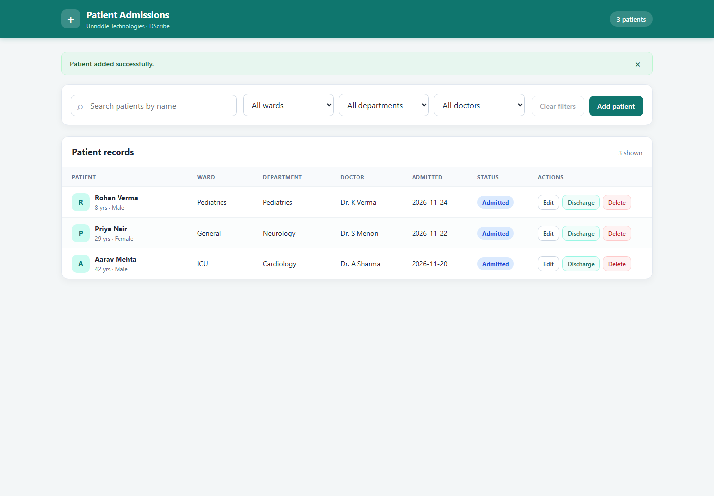
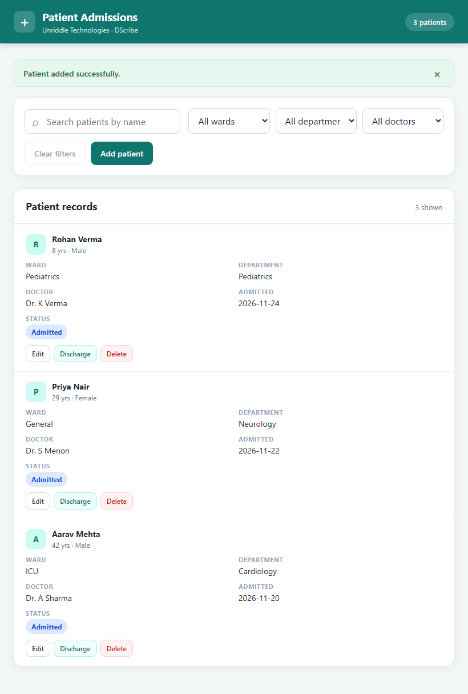
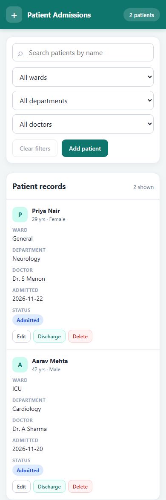
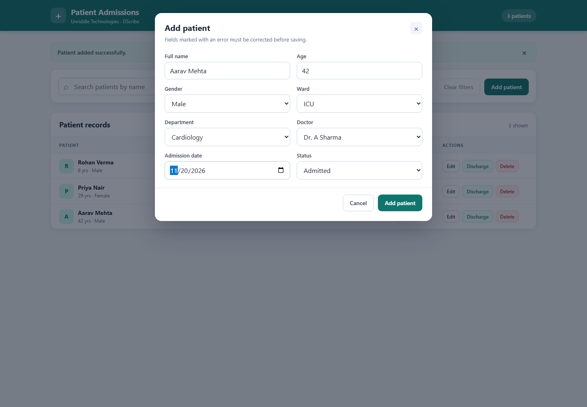
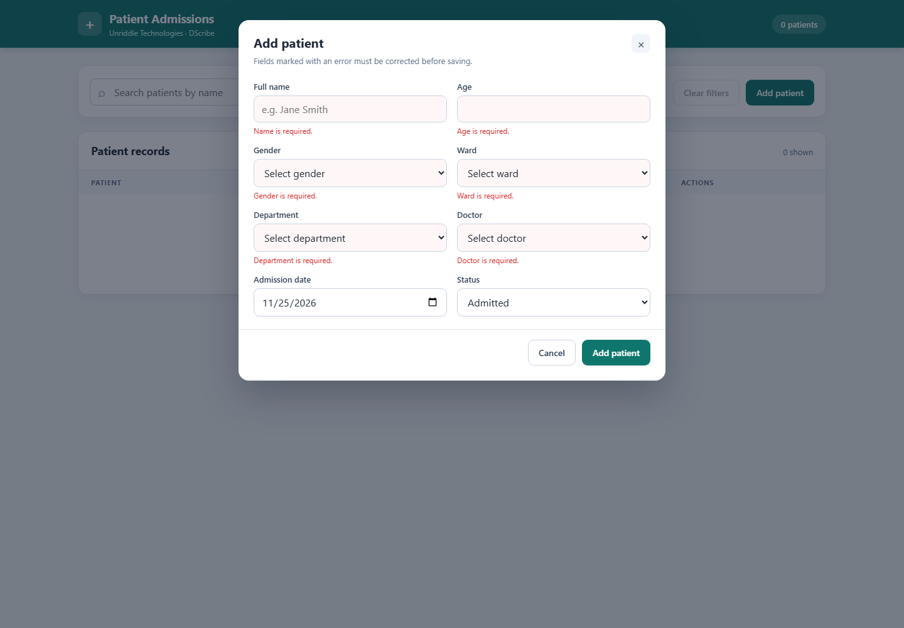

# Patient Admission Management App

A small web app for hospital staff to add, review, filter, edit, discharge, and delete admitted patients. The React client and the Python API are served from one URL, so the live deployment is a single service.

## Tech stack

| Layer | Choice |
| --- | --- |
| Frontend | React 19, Vite, plain CSS |
| Backend | Python 3, FastAPI |
| Database | SQLite, stored in `backend/data/patients.db` |
| Tests | Python `unittest`, Playwright |

No login is required and the repository contains no secrets.

## Features

1. Add a patient.
2. View all patients in a responsive list.
3. Filter by ward, department, and doctor.
4. Search patients by name.
5. Edit a patient.
6. Delete a patient after confirmation.
7. Mark a patient as discharged with one click.
8. Layout adapts to mobile, tablet, and desktop.

## Validation

Every rule runs in the browser and again on the server. The server returns HTTP 400 with a field-level message such as `"Age must be a number between 0 and 120."`

| Field | Rule |
| --- | --- |
| Name | Required, letters and spaces only |
| Age | Required, integer from 0 to 120 |
| Gender | Required, one of Male, Female, Other |
| Ward | Required, one of the six predefined wards |
| Department | Required, one of the six predefined departments |
| Doctor | Required, one of the six predefined doctors |
| Admission date | Required, valid `YYYY-MM-DD`, not in the future |
| Status | Admitted or Discharged |

The allowed values live in `frontend/src/constants.js` and `backend/domain.py`. Add a ward, department, or doctor in both files to extend the lists.

## Run locally

### Single URL

```bash
cd frontend
npm install
npm run build
cd ..
uv venv .venv
uv pip install -r backend/requirements.txt
uvicorn app:app --app-dir backend --host 0.0.0.0 --port 8000
```

Open `http://localhost:8000`. The API is at `http://localhost:8000/api/patients`.

### Development with hot reload

Start the API first:

```bash
uvicorn app:app --app-dir backend --host 127.0.0.1 --port 8000
```

Then start Vite in a second terminal:

```bash
cd frontend
npm install
npm run dev
```

Open `http://localhost:5173`. Vite forwards `/api` requests to port 8000.

## API

| Method | Path | Purpose |
| --- | --- | --- |
| `GET` | `/api/patients` | List patients, with optional `search`, `ward`, `department`, `doctor` query parameters |
| `POST` | `/api/patients` | Create a patient |
| `PUT` | `/api/patients/{id}` | Replace a patient |
| `PATCH` | `/api/patients/{id}/discharge` | Mark a patient as discharged |
| `DELETE` | `/api/patients/{id}` | Delete a patient |

## Tests

```bash
uv pip install -r backend/requirements.txt
python -m unittest discover -s backend/tests -v
```

With the server running, the browser smoke test also writes the screenshots:

```bash
uv pip install playwright
python -m playwright install chromium
python scripts/ui_smoke.py
```

## Deployment

Use any host that can install `backend/requirements.txt` and run a Python command. Build the React app before starting the server so `frontend/dist` exists. Start with:

```bash
uvicorn app:app --host 0.0.0.0 --port $PORT
```

Mount a persistent disk at `backend/data` so the SQLite file survives restarts and redeploys. The same process serves the built frontend and the API.

## Screenshots

### Desktop



### Tablet



### Mobile



### Add patient form



### Validation errors


